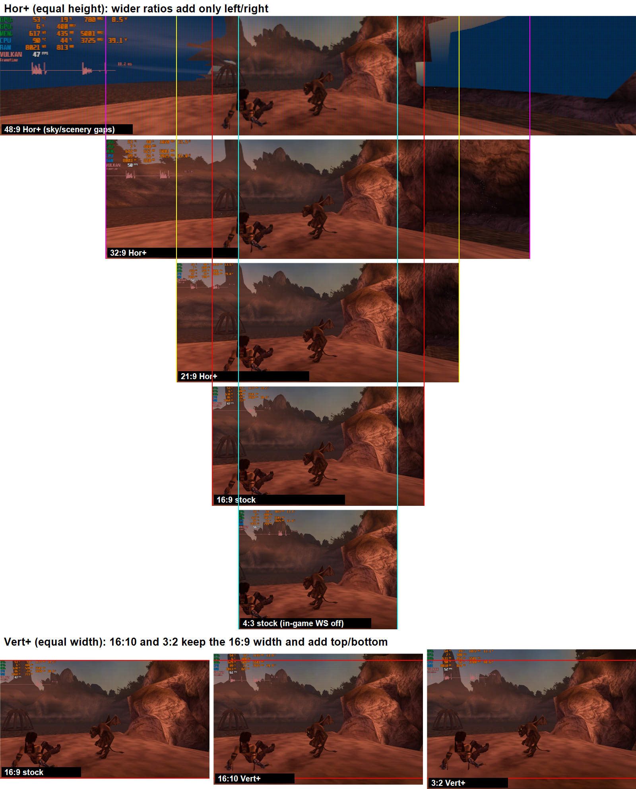

# Primal (PS2) – Ultrawide / Multi-Ratio Widescreen + 60 FPS Patch for PCSX2

A `.pnach` patch for **Primal (NTSC-U, SCUS-97142, CRC `FCD89DC3`)** on **PCSX2** that adds real extra field of view
at ratios other than the game's built-in 4:3 and 16:9, plus a video-safe 60 FPS option.

The game already has an anamorphic 16:9 mode in *Options > Display > widescreen*. This patch reuses that code path and
changes only the aspect value (and, for narrower ratios, the field of view), so everything is true Hor+ / Vert+
rather than a stretched image.



*Top: Hor+ at 48:9, 32:9, 21:9, then stock 16:9 and 4:3 for reference (equal height). Bottom: Vert+ at 16:10 and 3:2
(equal width). Captures from the same save-state position.*

## Features

| Section in PCSX2 | Ratio | Type | Status |
|---|---|---|---|
| Widescreen 21:9 (Hor+) | 64:27 (2.3704) | extra view left/right | validated (gameplay, cutscenes) |
| Widescreen 32:9 (Hor+) | 3.5556 | extra view left/right | validated in gameplay |
| Widescreen 48:9 (Hor+, experimental) | 5.3333 | extra view left/right | sky/backdrop does not reach the edges |
| Widescreen 16:10 (Vert+) | 1.6 | 16:9 width, extra top/bottom | validated (gameplay) |
| Widescreen 3:2 (Vert+) | 1.5 | 16:9 width, extra top/bottom | validated (gameplay, cutscenes) |
| 60 FPS (video-aware) | – | 60 fps gameplay and real-time cutscenes | validated |

- **4:3 and 16:9 are left to the game.** With in-game widescreen OFF, the game stays stock 4:3 under every section,
  and 16:9 is the game's own mode.
- **Hor+** (wider than 16:9): the vertical view is identical to 16:9, the extra picture appears on the sides.
- **Vert+** (narrower than 16:9): the horizontal view is identical to 16:9, the extra picture appears above and below.
- **60 FPS (video-aware):** the old simple 60 fps code made prerecorded videos play fast and end early (the intro FMV
  jumped to the hospital). This version hooks the vsync handler and keeps stock pacing while a video plays.
  It can be combined with any one widescreen section.
- **Pause menu:** the side column (logo, orbs, portrait, icons) is corrected to keep correct proportions at wide ratios.

## Known limitations

- **Gameplay HUD is not corrected.** It stretches at ratios wider than 16:9 (about 2x at 32:9).
- **Pause menu main panels, text and the map** stay stretched, which is the stock behaviour of the game's widescreen mode.
- **Loading screens** stretch at wide ratios (not investigated yet).
- **48:9** shows blue void at the sides because the sky/backdrop does not reach the screen edge. 32:9 is clean.
- **FMVs are pre-rendered** and cannot be widened. Set PCSX2's *FMV Aspect Ratio* to *Widescreen (16:9)* (see
  `INSTALL.txt`) so they play pillarboxed instead of stretched. The title/main menu are FMV-backed and use this too.
- **Tick one ratio section only**, and keep the in-game widescreen option ON.
- Switching sections while the game runs may leave the previous section's code in memory until the game is restarted.
- Tested on PCSX2 with the Vulkan renderer, NTSC-U disc only. Other regions have different addresses.

## Installation

See [`INSTALL.txt`](INSTALL.txt) for step-by-step instructions. Short version:

1. Copy `patches/FCD89DC3.pnach` into PCSX2's `patches` folder.
2. Enable *Enable Patches* in PCSX2, then tick **one** ratio section (and optionally *60 FPS (video-aware)*) under
   *Game Properties > Patches*.
3. Turn ON *Options > Display > widescreen* in the game.
4. Set PCSX2's *FMV Aspect Ratio* to *Widescreen (16:9)* and the display aspect ratio to *Stretch to window / Auto*.
5. For the 60 FPS section, set PCSX2's EE Cycle Rate to 130%.

## How it works

The game stores its widescreen option at `0x004883FC` and picks between a 4:3 and a 16:9 constant at two code sites:

| Site | Address | Purpose |
|---|---|---|
| A | `0x00260798` / `0x0026079C` | main camera projection call |
| B | `0x001F2774` / `0x001F2778` | per-viewport copies |

The game's field of view is vertical, so replacing the 16:9 aspect constant with the target ratio gives correct Hor+ at
any ratio. For narrower ratios, a small code cave at `0x000F8000` also scales the field of view by `(16/9)/aspect`,
so the horizontal view stays equal to 16:9 and the extra view goes top and bottom. The 60 FPS hook lives at
`0x000F8040`. Everything is applied only when the in-game widescreen option is on, so 4:3 stays stock.

The patch file itself is commented. Open work (gameplay HUD, full pause menu, loading screens) with useful addresses
and leads is in [`docs/FUTURE_HUD_MENU_WORK.md`](docs/FUTURE_HUD_MENU_WORK.md).

## Repository layout

```
patches/FCD89DC3.pnach              the patch (copy this into PCSX2)
INSTALL.txt                         install and setup instructions
docs/FUTURE_HUD_MENU_WORK.md        open work: HUD, pause menu, loading screens
images/FINAL_comparison_all_ratios.png
```

## Contributing

Help is welcome, especially with the gameplay HUD, full pause-menu squeeze (glyph width and map clipping), loading
screens, and extending the sky/backdrop for 48:9. The leads and next steps are listed in
`docs/FUTURE_HUD_MENU_WORK.md`.

## Disclaimer

This repository contains only a patch file (memory address and value pairs). It contains no game data. You need your
own legally obtained copy of the game. Primal is a trademark of its respective owners. This project is not affiliated
with Sony, Sony Computer Entertainment or the PCSX2 team.
